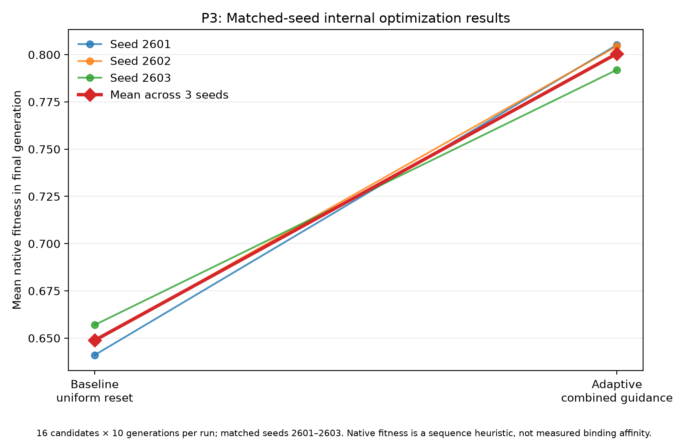
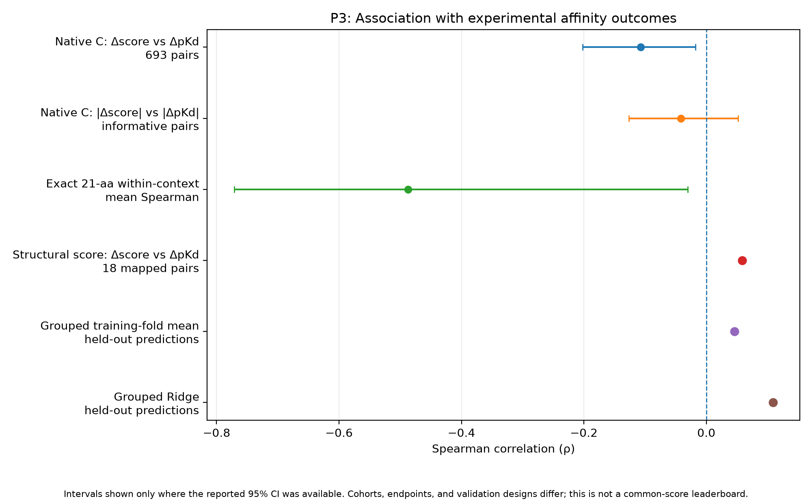
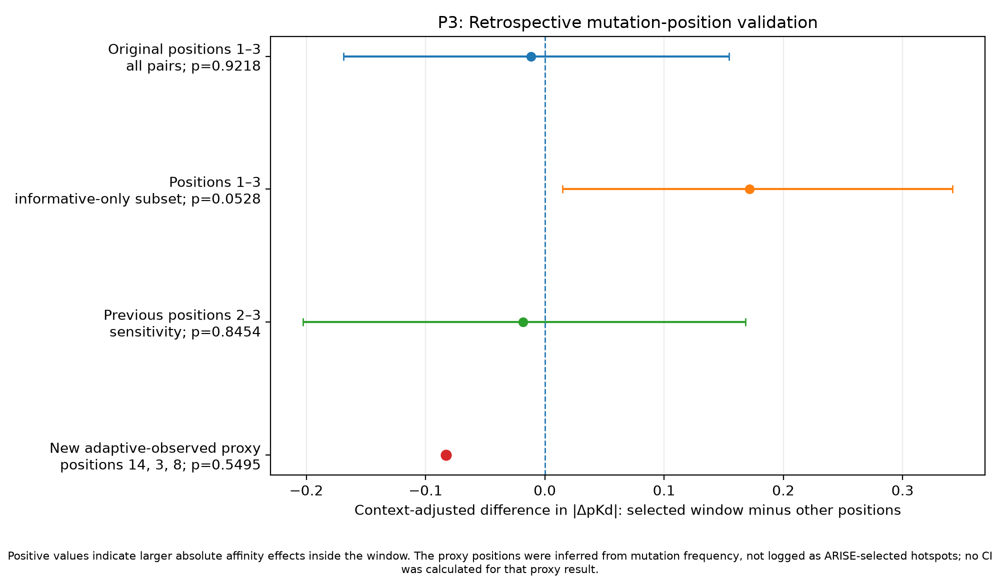
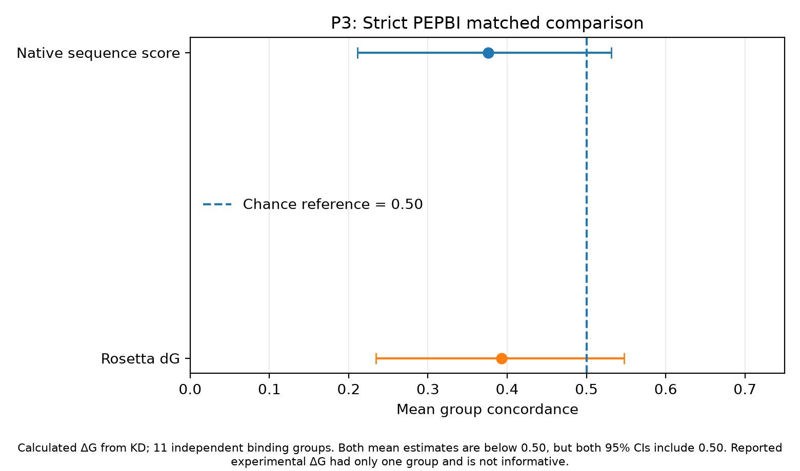
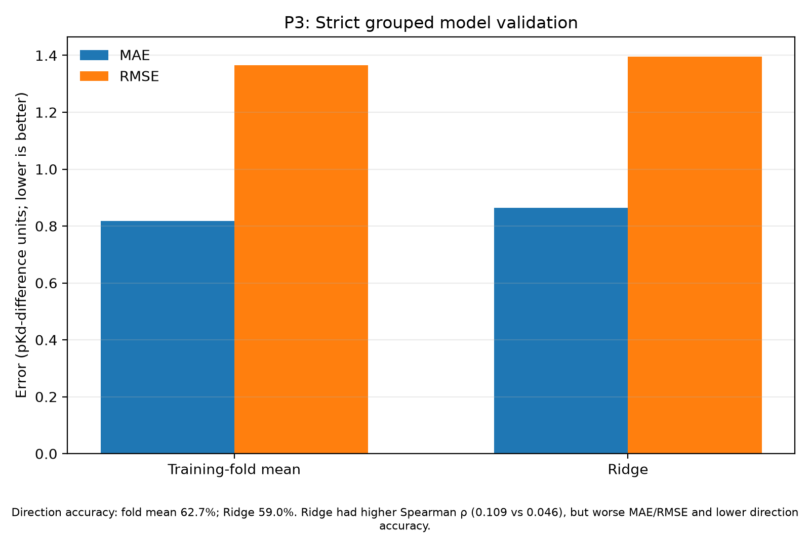

# P3 Data Logbook Entry — Silicon Virovore

**Work date:** 26 October 2026 (America/New_York).  
**Scope:** P3 external retrospective validation plus a new matched-seed optimizer comparison.  
**Purpose of this entry:** preserve the experimental setup, numerical outputs, provenance, and missing-data status without interpreting or omitting negative results.

## 1. Research questions

1. Under matched run budgets, does the adaptive search policy attain higher values of the pipeline's internal fitness objective than a uniform-reset baseline?
2. Do selected mutation positions correspond to positions with larger experimentally measured affinity effects?
3. Does the native sequence score track experimentally measured affinity changes?
4. Do independent PEPBI and structural-scoring benchmarks support receptor-specific binding-affinity prediction?
5. Does a separate sequence-only Ridge predictor improve on a training-fold mean when validation prevents target, peptide, and exact-pair overlap?

These are separate questions. A better internal fitness value is not itself evidence of higher experimental affinity.

## 2. Optimizer comparison: experimental configuration

Six pipeline runs were completed in `prototype3/results/p3_paired_arm_20261027T022810Z/`.

- Matched seeds: **2601, 2602, 2603**.
- Candidate budget: **16 candidates × 10 generations = 160 records per run**.
- Shared explicit settings: starting sequence `MKLAVFALLVFFAGSSDLIRR` (21 residues), mutation rate 0.05, elite count 2, tournament size 3.
- Adaptive arm: `hotspot_entropy_substitution_epistasis_exploratory_v2`, under adaptive configuration.
- Baseline arm: `uniform_random_reset`, under baseline configuration.
- Both arms used the same seed values and recorded run output files under their respective run directories.

**Design caveat:** this compares two *overall policy configurations*. The reset baseline returns to the initial seed, while the adaptive policy follows an evolving parent. The comparison therefore does not isolate mutation guidance as the only causal difference.

### Optimizer results

| Arm | Seed | Candidate records | Unique sequences | Mean fitness over records | Best fitness | Final-generation mean |
|---|---:|---:|---:|---:|---:|---:|
| baseline | 2601 | 160 | 138 | 0.65109 | 0.70555 | 0.64102 |
| baseline | 2602 | 160 | 135 | 0.65268 | 0.71454 | 0.64842 |
| baseline | 2603 | 160 | 125 | 0.65295 | 0.70720 | 0.65695 |
| adaptive | 2601 | 160 | 151 | 0.75933 | 0.84330 | 0.80516 |
| adaptive | 2602 | 160 | 151 | 0.75315 | 0.84553 | 0.80448 |
| adaptive | 2603 | 160 | 151 | 0.73549 | 0.83327 | 0.79200 |

Across the three seeds:

| Summary | Baseline | Adaptive | Adaptive minus baseline |
|---|---:|---:|---:|
| Mean fitness over all records, averaged by seed | 0.65224 | 0.74933 | +0.09708 |
| Best fitness per run, averaged over seeds | 0.70909 | 0.84070 | +0.13160 |
| Final-generation mean, averaged over seeds | 0.64880 | 0.80055 | +0.15175 |
| Unique sequences per run, averaged over seeds | 132.67 | 151.00 | +18.33 |

All three matched seeds favored the adaptive policy on final-generation mean fitness. Three seeds are an exploratory sample; these descriptive results alone do not establish generalizable statistical superiority.

Per-seed paired differences are saved in `optimizer_paired_differences.csv`; the six source runs and summary values are in `optimizer_seed_metrics.csv`.

## 3. PPIKB/native-score retrospective mutation benchmark

Input evidence: `prototype3/results/native_score_all_mutation_pairs/scored_mutation_pairs.csv`.

- 693 matched single-substitution pairs.
- 621 unique peptides; 123 target sequences.
- Peptide lengths represented: 9–20 amino acids.
- 466 informative pairs had absolute experimental ΔpKd at least 0.3.

| Measure | Result |
|---|---:|
| Spearman correlation, Δnative score vs ΔpKd | −0.1071 |
| 95% cluster-bootstrap CI for that correlation | [−0.2022, −0.0176] |
| Informative-pair direction accuracy, ties counted half | 42.49% |
| 95% CI for direction accuracy | [36.55%, 47.78%] |
| Spearman correlation, absolute score change vs absolute pKd change | −0.0418 |
| 95% CI for absolute-change correlation | [−0.1262, +0.0519] |
| Position-profile association | ρ = −0.1354; shuffle p = 0.223 |

The native C score is a sequence-level heuristic with `target=NULL` in the scoring call. This test is not a target-aware docking or binding-affinity calculation. It measures retrospective score/affinity association on external peptide–protein data, not direct affinity outcomes for newly generated candidates.

## 4. Exact 21-amino-acid benchmark

Source directory: `prototype3/results/p3_21aa_affinity_audit/native_c_score_21aa/`.

- 129 eligible measurement rows; 67 distinct peptides.
- 73 target/assay/publication contexts.
- Only 7 contexts had at least 3 peptides with variable score and affinity.
- 20 single-substitution context rows; 9 informative pairs; 7 unique peptide pairs and 5 mutation positions.

Results:

- Mean within-context Spearman ρ: **−0.4872**.
- Group-bootstrap 95% CI: **[−0.7714, −0.0301]**.
- Informative-pair direction accuracy: **1/9 = 11.11%**.
- In the recorded analysis, 8 of 9 informative rows showed experimental affinity increasing while the native score decreased.

This is an exact-length subset relevant to the optimizer's 21-residue seed, but its informative-pair count is very small and the group estimate is exploratory.

## 5. ARISE mutation-position validation against experimental data

Source: `prototype3/results/arise_experimental_position_audit/` and the prior P3 report.

The primary retrospective test compared positions 1–3 with random contiguous windows of equal width. It did **not** find a reliable primary advantage.

| Test | Context-adjusted effect | 95% CI | Two-sided permutation p |
|---|---:|---:|---:|
| Positions 1–3, all pairs (693) | −0.0115 | [−0.1690, +0.1543] | 0.9218 |
| Previous positions 2–3 sensitivity test | −0.0184 | [−0.2026, +0.1684] | 0.8454 |
| Positions 1–3, filtered informative subset (466 pairs) | +0.1716 | [+0.0148, +0.3419] | 0.0528 |

The informative-only result is secondary and exploratory because it filters to larger observed affinity changes; it is not the primary all-pairs outcome. These peptides are not the same as the HERV-K Env search candidates.

## 6. New adaptive-observed mutation-position proxy

The newer optimizer artifacts did not expose explicitly logged selected ARISE hotspot positions. A separate audit extracted mutation events from parent/child sequence records and chose the three most frequently mutated adaptive positions that were represented in the external pair benchmark: **14, 3 and 8**.

These are labeled as an *observed-mutation proxy*, not actual logged ARISE-selected hotspots.

- Adaptive parent/child mutation events extracted: **510**.
- Baseline parent/child mutation events extracted: **480**.
- Adaptive events at positions 14, 3 or 8: **19.61%**.
- Baseline events at those same positions: **12.08%**.
- External pairs inside/outside the proxy positions: **179 / 514**.
- Context-adjusted external effect, inside minus outside: **−0.0828**.
- Equal-size random-position permutation p: **0.5495**.

The test did not show that the proxy positions have larger external affinity effects than other positions. The same external positional statistic was used for both arms; the arm-specific measurement is the fraction of each arm's mutation events falling inside the proxy positions.

Full source: `prototype3/results/p3_paired_arm_20261027T022810Z/p3_validation_comparison/CORRECTED_MUTATION_POSITION_AUDIT.md`.

## 7. PEPBI matched validation

Input workbook: `prototype3/data/raw/PEPBI.xlsx`.

For the strict matched analysis of calculated ΔG from K_D:

| Predictor | Mean group concordance | Independent binding groups | 95% group-bootstrap CI |
|---|---:|---:|---:|
| Native sequence score | 0.3762 | 11 | [0.2110, 0.5315] |
| Rosetta dG | 0.3927 | 11 | [0.2345, 0.5475] |

The point estimates are below the 0.50 chance reference, but both intervals include 0.50. The separately reported experimental-ΔG comparison had only one independent binding group; its zero concordance estimate is not a reliable predictive-quality estimate.

The receptor-context invariance control examined 4 matched peptide contexts and 24 receptor-variant pairs. The native score changed in **0/24** pairs, while **7** pairs had experimental ΔG differences greater than 0.5 kcal/mol. That is expected for a score that depends on the peptide sequence alone; it limits use as a receptor-specific predictor.

The new optimizer-candidate audit found **0 exact sequence matches** between its generated sequences and the PEPBI workbook. Consequently, the current PEPBI metrics are retrospective validation of the fixed scoring method, not separate adaptive-versus-baseline prediction accuracies.

## 8. Structural benchmark

Existing benchmark source: `prototype3/results/experimental_mutation_benchmark/structural_scoring_20261026T223525Z/benchmark_metrics.json`. This result was **carried forward**, not rerun as a fresh optimizer-arm comparison.

- 18 mapped mutation pairs, 7 targets and 28 unique complex-chain combinations.
- Overall Spearman ρ between structural-score change and experimental ΔpKd: **+0.0588**, exploratory p = **0.8167**.
- Direction accuracy: **50%**.
- Informative subset: 14 pairs, ρ = **+0.0593**, p = **0.8403**, 50% direction accuracy.
- Same-observed-receptor-sequence subset: 10 pairs across 5 targets, ρ = **+0.2849**, p = **0.4250**, 60% direction accuracy; bootstrap intervals were wide and included no association.

A structural pose sanity check on the MDM2/p53 1YCR complex found 85 receptor Cα correspondences, 13 peptide Cα matches after alignment, and an aligned docked-pose peptide RMSD of 9.965 Å. The score preferred the poor docked pose over the crystal reference (reported scores 0.97751 vs 0.96537). This raises a validation concern about pose ranking.

The new optimizer-run folders contained **0 candidate-run PDB files** available to score, so there were no new structural scores for candidates from either arm.

## 9. Grouped sequence-only Ridge versus training-fold mean

Fresh run: `prototype3/results/p3_paired_arm_20261027T022810Z/grouped_sequence_validation/run_20261027T023029Z/metrics.json`.

Validation used 5 GroupKFold folds built from 111 connected components across 693 pairs and 123 target sequences. The grouping links rows sharing a target sequence, peptide sequence or exact unordered peptide pair. The split audit reports no target, peptide or exact-pair overlap across the folds.

| Model | MAE | RMSE | Spearman ρ | Direction accuracy | Direction coverage |
|---|---:|---:|---:|---:|---:|
| Training-fold mean | 0.8182 | 1.3656 | 0.0459 | 62.66% | 100.00% |
| Ridge | 0.8643 | 1.3957 | 0.1087 | 58.96% | 90.99% |

Ridge had a larger Spearman estimate, but worse MAE, worse RMSE and lower informative-direction accuracy. The reported paired bootstrap CI for the Ridge-minus-mean rho difference was [−0.0637, +0.1726], including zero. This is a separate sequence-only model comparison, not evidence that the optimizer improves.

## 10. P3 batch execution status

The prior retrospective P3 batch reported successful execution for all ten listed steps:

- PPIKB preprocessing
- Grouped sequence validation
- Native-score mutation-pair benchmark
- Exact 21-aa benchmark
- ARISE position validation
- Corrected PEPBI benchmark
- Strict PEPBI matched benchmark
- PEPBI receptor-context invariance
- Verified single-substitution PEPBI audit
- Exploratory native-score PEPBI audit

**PASS refers to script execution, not to confirmation of the scientific hypothesis.** The structural mutation benchmark was separately carried forward from its existing results.

## 11. Data availability and exclusions

The candidate-specific tests could not yield direct affinity or new structural accuracy metrics for the six optimizer runs:

- Exact generated-sequence matches to the measured pKd dataset: **0**.
- Exact generated-sequence matches to the PEPBI workbook: **0**.
- Candidate-run complex PDB files available for fresh structural scoring: **0**.
- Explicit adaptive-selected hotspot positions recoverable from the new run artifacts: **0 seeds**.

No measured affinity or structural result has been imputed for a candidate without evidence. The proxy-position analysis is explicitly marked as such. The original data and earlier output directories were preserved.

## 12. Provenance and saved outputs

See `P3_EVIDENCE_REGISTER.csv` for the status and source of each analysis.

Important paths:

- Prior consolidated retrospective report: `prototype3/reports/p3_baseline_rerun_20261027T020504Z/P3_BASELINE_COMPARISON.md`
- Matched optimizer runs: `prototype3/results/p3_paired_arm_20261027T022810Z`
- Corrected mutation-position audit: `prototype3/results/p3_paired_arm_20261027T022810Z/p3_validation_comparison/CORRECTED_MUTATION_POSITION_AUDIT.md`
- Consolidated new validation audit: `prototype3/results/p3_paired_arm_20261027T022810Z/p3_validation_comparison/P3_ADAPTIVE_BASELINE_VALIDATION.md`
- Grouped model metrics: `prototype3/results/p3_paired_arm_20261027T022810Z/grouped_sequence_validation/run_20261027T023029Z/metrics.json`
- Existing structural benchmark: `prototype3/results/experimental_mutation_benchmark/structural_scoring_20261026T223525Z/benchmark_metrics.json`

The five graphs are stored under `graphs/`. Numeric plot inputs and seed values are preserved as CSV files in this logbook folder.
