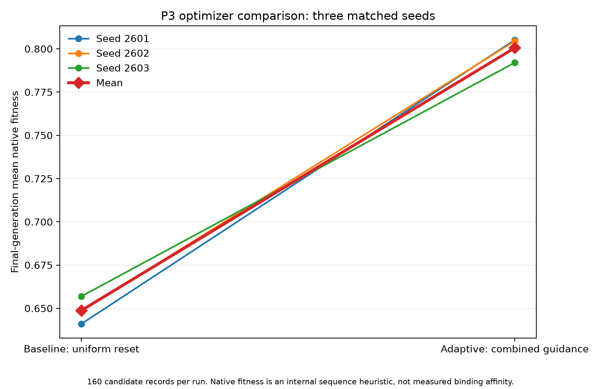
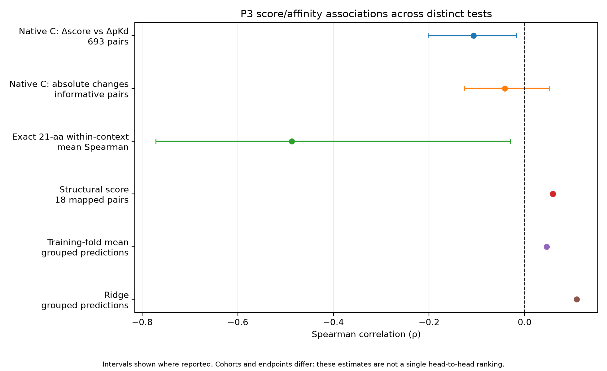
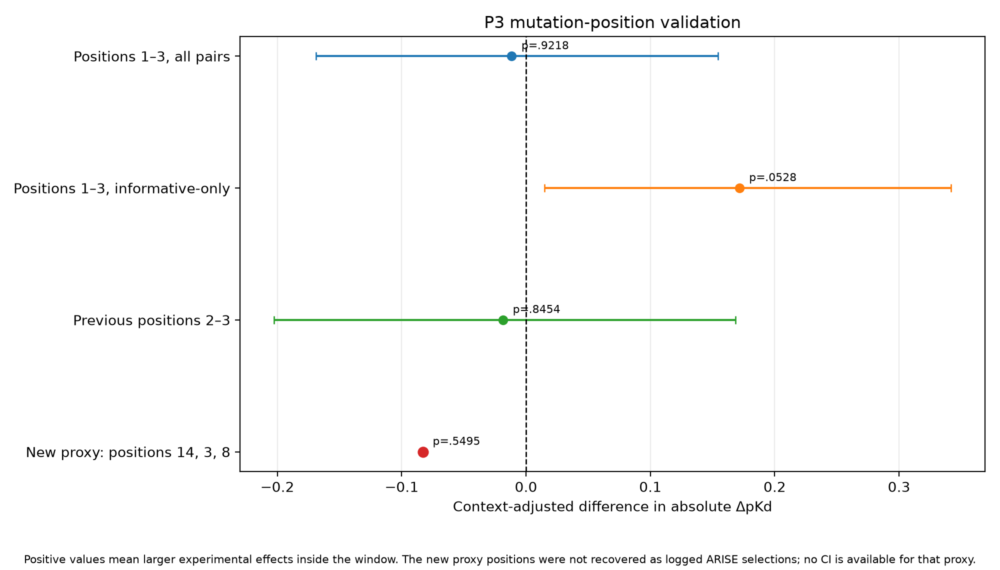
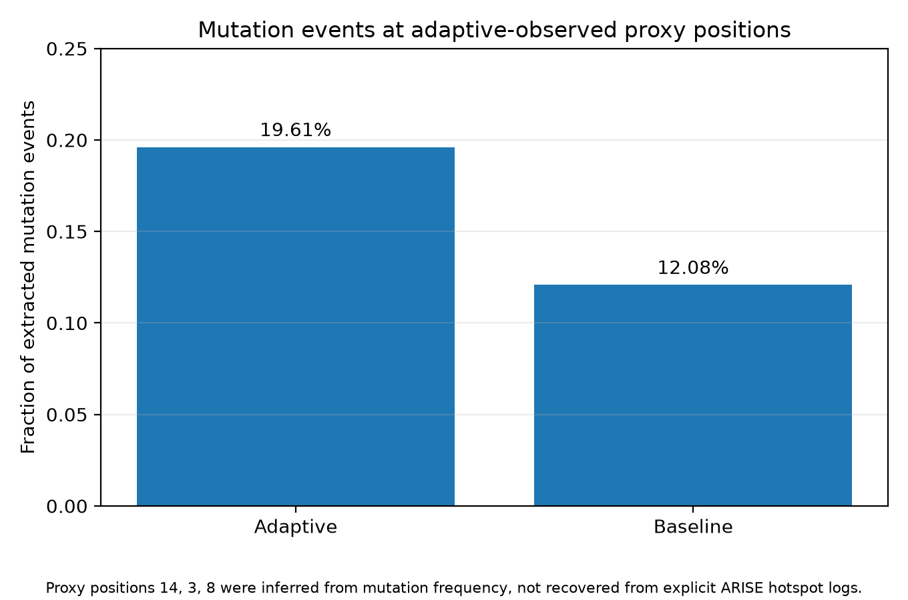
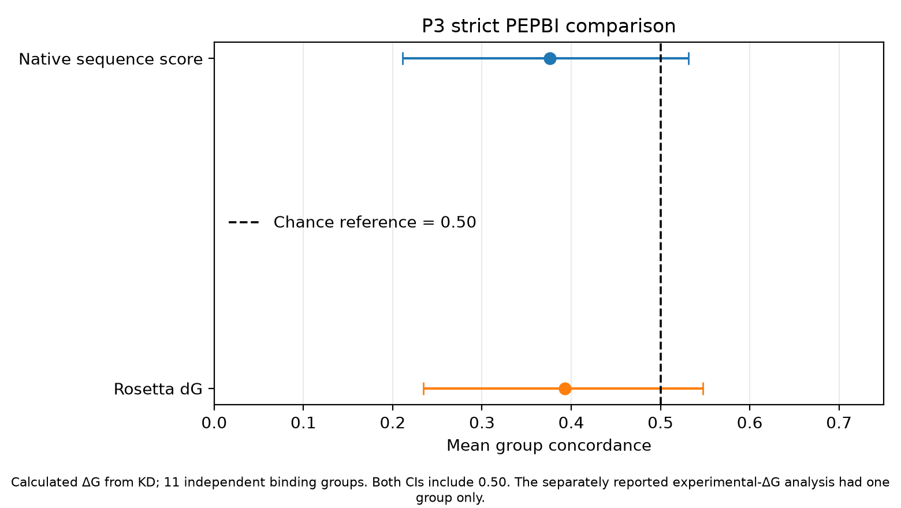
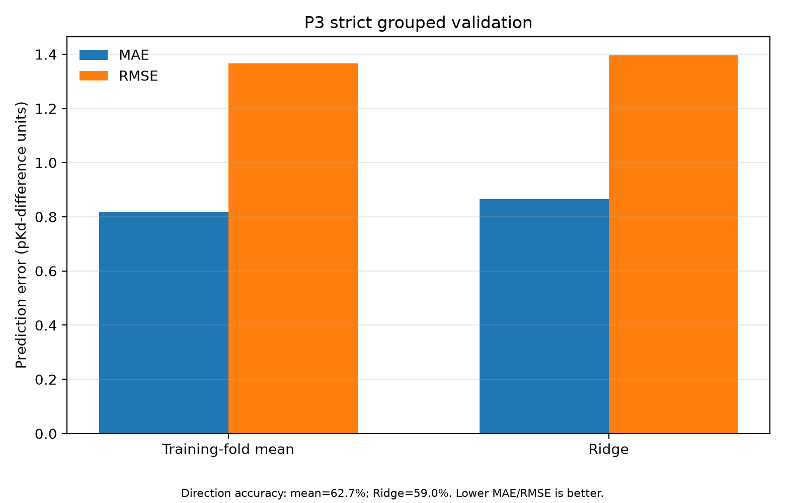

# P3 DATA LOGBOOK — Silicon Virovore

**Research period documented:** 26 October 2026 (local time).  
**Scope:** completed P3 retrospective validations and the new 3-seed matched optimizer comparison.  
**Purpose:** preserve numerical observations, configurations, data provenance, and missing evidence.

## 1. Research questions and reporting hierarchy

P3 contains two distinct scientific questions:

1. Does an adaptive search policy improve the pipeline's internal optimization objective compared with a baseline?
2. Do the pipeline's scores and selected positions correspond to experimentally measured affinity changes or validated receptor–peptide structures?

These questions are not interchangeable. For this consolidated record, final-generation mean native fitness is the **primary reported endpoint for the optimizer comparison**. This reporting hierarchy is being formalized during documentation after the runs; it was not preregistered before them. Other optimizer metrics are secondary/exploratory.

For affinity validation, the primary reported retrospective measures are the broad native-score association with measured mutation effects, the all-pairs ARISE window test, and the strict matched PEPBI group-concordance result. The exact-21-aa and new position-proxy results are exploratory or limited by small samples.

## 2. New optimizer comparison: methods and measurements

**Runs:** `prototype3/results/p3_paired_arm_20261027T022810Z/`

- Three matched seeds: 2601, 2602, 2603.
- 16 candidates × 10 generations = 160 recorded candidate records per run.
- Shared seed peptide: `MKLAVFALLVFFAGSSDLIRR` (21 aa).
- Mutation rate: 0.05.
- Elite count: 2.
- Tournament size: 3.
- Adaptive mode: `hotspot_entropy_substitution_epistasis_exploratory_v2`.
- Baseline mode: `uniform_random_reset`.

| Arm | Seed | Records | Unique sequences | Mean fitness over records | Best fitness | Final-generation mean |
|---|---:|---:|---:|---:|---:|---:|
| Baseline | 2601 | 160 | 138 | 0.65109 | 0.70555 | 0.64102 |
| Baseline | 2602 | 160 | 135 | 0.65268 | 0.71454 | 0.64842 |
| Baseline | 2603 | 160 | 125 | 0.65295 | 0.70720 | 0.65695 |
| Adaptive | 2601 | 160 | 151 | 0.75933 | 0.84330 | 0.80516 |
| Adaptive | 2602 | 160 | 151 | 0.75315 | 0.84553 | 0.80448 |
| Adaptive | 2603 | 160 | 151 | 0.73549 | 0.83327 | 0.79200 |

### Across-seed summary

| Metric | Baseline mean | Adaptive mean | Adaptive − baseline |
|---|---:|---:|---:|
| Mean candidate-record fitness | 0.65224 | 0.74933 | +0.09708 |
| Best score per run | 0.70909 | 0.84070 | +0.13160 |
| Final-generation mean fitness | 0.64880 | 0.80055 | +0.15175 |
| Unique sequences per run | 132.67 | 151.00 | +18.33 |

All three matched seeds favored adaptive for final-generation mean native fitness. This is an encouraging descriptive result for the tested search configurations.

**Design qualification:** `uniform_random_reset` returns to the initial seed each generation while the adaptive arm follows an evolving parent. Therefore, this test compares the overall policies and does not isolate mutation guidance from parent/reset behavior. Three seeds provide preliminary evidence, not a high-powered general claim.

## 3. Broad native C score versus experimental mutation effects

Source: `prototype3/results/native_score_all_mutation_pairs/scored_mutation_pairs.csv`.

- 693 matched single-substitution pairs.
- 621 unique peptides and 123 target sequences.
- Peptide lengths 9–20 aa.
- 466 informative pairs with |ΔpKd| ≥ 0.3.

| Measurement | Result |
|---|---:|
| Spearman ρ, Δnative score vs ΔpKd | −0.107139 |
| 95% cluster-bootstrap CI | [−0.20220, −0.01755] |
| Informative direction accuracy, ties half | 42.49% |
| Direction-accuracy 95% CI | [36.55%, 47.78%] |
| Spearman ρ, absolute score change vs absolute ΔpKd | −0.04183 |
| 95% CI for absolute-change correlation | [−0.1262, +0.0519] |
| Position-profile association | ρ = −0.1354; shuffle p = 0.223 |

The C score uses a target-null sequence-level fitness calculation. These results do not demonstrate target-specific binding affinity and do not directly measure the newly generated candidates.

## 4. Exact 21-aa affinity subset

Source: `prototype3/results/p3_21aa_affinity_audit/native_c_score_21aa/`.

- 129 eligible measurement rows.
- 67 unique peptides and 73 target/assay/publication contexts.
- Seven contexts had at least three peptides with variable score and affinity.
- 20 single-substitution context rows; nine informative pairs; seven unique peptide pairs and five mutation positions.
- Mean within-context Spearman ρ = −0.4872; 95% group-bootstrap CI [−0.7714, −0.0301].
- Informative direction accuracy = 1/9 = 11.11%.

This is relevant to the 21-aa optimizer seed length, but it is a small exploratory subset and cannot support a precise general estimate.

## 5. ARISE mutation-position validation

Source: `prototype3/results/arise_experimental_position_audit/`.

| Analysis | Context-adjusted difference | 95% CI | Two-sided permutation p |
|---|---:|---:|---:|
| Positions 1–3; all pairs (693) | −0.0115 | [−0.1690, +0.1543] | 0.9218 |
| Positions 2–3; sensitivity check | −0.0184 | [−0.2026, +0.1684] | 0.8454 |
| Positions 1–3; informative-only (466) | +0.1716 | [+0.0148, +0.3419] | 0.0528 |

The all-pairs test is the primary result and found no reliable advantage. The filtered informative-only result is secondary/exploratory; it is not independent confirmation. The external peptides differ from the optimizer seed and are not HERV-K Env-specific measurements.

## 6. New mutation-pattern proxy audit

The new run artifacts did not reveal explicitly logged selected ARISE hotspot positions. The follow-up instead used positions 14, 3 and 8, identified from the most frequent adaptive mutation events that were represented in the experimental dataset. These are **observed-mutation proxy positions**, not confirmed ARISE selections.

- Adaptive parent–child mutation events extracted: 510.
- Baseline events extracted: 480.
- Fraction of events at positions 14, 3 or 8: adaptive 19.61%; baseline 12.08%.
- External pairs inside/outside those positions: 179 / 514.
- Context-adjusted effect: −0.0828.
- Random equal-size position-set permutation p = 0.5495.

The proxy position set did not show larger external affinity effects than the other positions. More frequent adaptive mutation at a position is not equivalent to demonstrating that the position is biologically important.

## 7. Strict PEPBI comparison and receptor-context control

For calculated ΔG from K_D:

| Predictor | Mean group concordance | Independent binding groups | 95% group-bootstrap CI |
|---|---:|---:|---:|
| Native sequence score | 0.3762 | 11 | [0.2110, 0.5315] |
| Rosetta dG | 0.3927 | 11 | [0.2345, 0.5475] |

Both point estimates were below the 0.50 reference, but both CIs included 0.50. The separate reported-ΔG test had one independent group and is insufficient for general conclusions.

Receptor-context invariance analysis: four matched peptide contexts, 24 receptor-variant pairs; the native score changed in 0 pairs, while 7 pairs had measured ΔG differences >0.5 kcal/mol. This illustrates the limitation of a peptide-only score for receptor-specific prediction.

The new candidate sequence scan found zero exact PEPBI sequence matches; therefore, the PEPBI result is a retrospective method benchmark and not separate accuracy evidence for each new optimizer arm.

## 8. Structural-scoring evidence

The existing structural mutation benchmark was **carried forward, not rerun** in the latest P3 batch.

- 18 mapped pairs; 7 target groups; 28 unique complex-chain combinations.
- Overall Spearman ρ = +0.0588; exploratory p = 0.8167.
- Direction accuracy = 50%.
- Informative subset: 14 pairs, ρ = +0.0593, p = 0.8403, direction accuracy 50%.
- Same observed receptor-sequence subset: 10 pairs, 5 targets, ρ = +0.2849, p = 0.425, direction accuracy 60%; reported intervals were broad.

The 1YCR MDM2/p53 pose sanity check reported 9.965 Å aligned peptide RMSD for the docked pose; the scorer gave that docked pose 0.97751 versus 0.96537 for the crystal pose, preferring the poor pose. This is a limitation of the scorer's current validation.

The six new optimizer output folders had zero candidate complex PDB files available for fresh target-aware scoring. Thus there is no new structural accuracy result for adaptive-generated versus baseline-generated candidates.

## 9. Strict grouped Ridge versus training-fold mean

Source: `prototype3/results/p3_paired_arm_20261027T022810Z/grouped_sequence_validation/run_20261027T023029Z/metrics.json`.

The validation used five folds over 111 connected components, covering 693 pairs and 123 target sequences. Connected-component grouping kept each target sequence, peptide sequence and exact unordered peptide pair within one fold; the audit reported no overlap across folds.

| Predictor | MAE | RMSE | Spearman ρ | Direction accuracy | Coverage |
|---|---:|---:|---:|---:|---:|
| Training-fold mean | 0.8182 | 1.3656 | 0.0459 | 62.66% | 100.00% |
| Ridge | 0.8643 | 1.3957 | 0.1087 | 58.96% | 90.99% |

Ridge had a higher Spearman estimate but worse MAE/RMSE and lower direction accuracy. The reported paired-bootstrap interval for the rho difference included zero. This is a separate sequence-only predictor evaluation—not an optimizer-arm comparison.

## 10. Candidate-specific evidence and execution status

- Exact generated-sequence matches to the scanned measured-pKd dataset: **0**.
- Exact generated-sequence matches to the PEPBI workbook: **0**.
- New-run complex PDB files available for fresh structural scoring: **0**.
- Recoverable explicit ARISE-selected hotspot sets in the six new runs: **0 seeds**.

The previous retrospective P3 batch reported that all ten listed scripts completed execution. The six new optimizer runs and fresh grouped Ridge evaluation also completed. **Successful execution does not mean the hypothesis passed.** The old structural result remains explicitly carried forward.

## 11. Provenance

See `P3_EVIDENCE_REGISTER.csv` and the CSV inputs to the graphs. Original result files and the earlier logbook bundle remain untouched.

This entry records the P3 work performed to date. It does not claim prospective affinity accuracy or demonstrated HERV-K Env binding.
